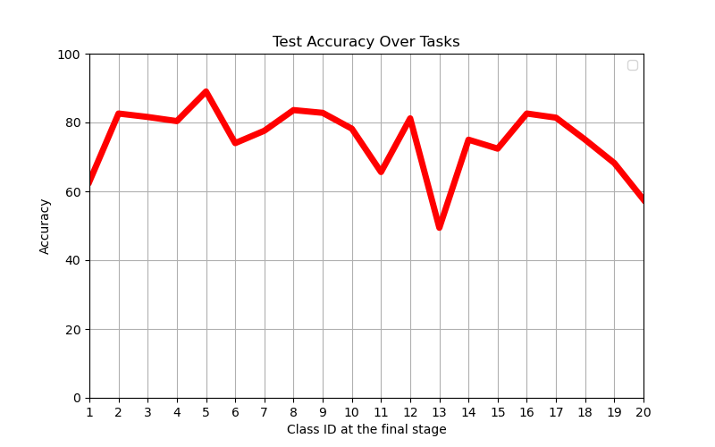
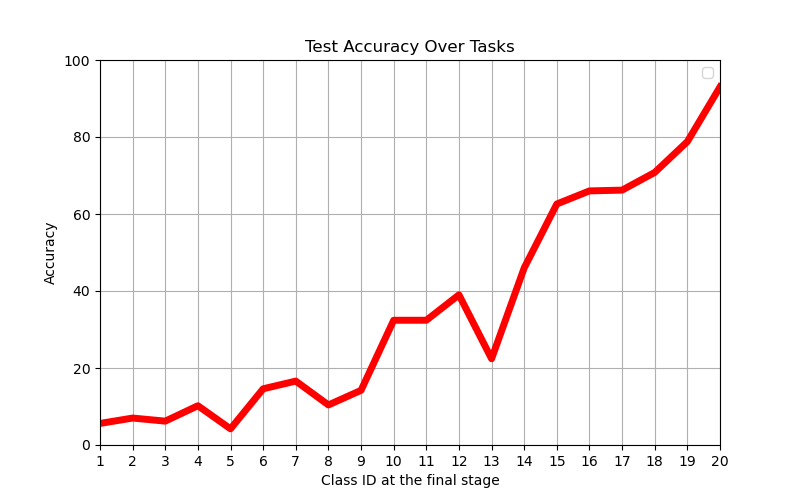

## **CH-HNN Project Code Repository**

**CH-HNN** is a hybrid neural network model for continual learning, inspired by cortico-hippocampal circuits.  
This repository contains the code to reproduce the experiments reported in our *Nature Communications* paper.

DOI: https://doi.org/10.1038/s41467-025-56405-9

## **System Requirements**
- **Operating System**: Ubuntu 20.04
- **Python Version**: 3.9.12
- **Dependencies**:

matplotlib==3.5.1
numpy==1.21.5
pygame==2.5.2
scikit_learn==1.0.2
torch==1.11.0+cu115
torchvision==0.12.0+cu115
tqdm==4.64.0

## **Installation**

Clone the repository and install the required packages:
```bash
git clone https://github.com/qqish/CH-HNN
cd CH-HNN
pip install -r requirements.txt
```

## **Preparation**

To extract embedding features from **CIFAR-100** or **TinyImageNet**, run:
```bash
python get_embedding_clip.py
```
This process takes about 5 minutes.

## **Example Demo**

To demonstrate class-incremental learning on CIFAR-100 with CH-HNN model, execute:
CH-HNN model:
```bash
python demo_test.py --ep-inference --dataset 'cifar100'
```

This will produce accuracy results for each of the 20 classes, saving them as "test_accuracy_results.png":


For the baseline model, use:
```bash
python demo_test.py --dataset 'cifar100'
```

Results are similar to the above:
 

## **Training Method**

The CH-HNN framework supports two different usage modes, depending on whether you want to reuse pretrained ANN models or train your own ANN from scratch.

---

## Option 1: Train SNN Using a Pretrained ANN

This is the recommended way to reproduce the reported results.

```bash
python manager.py --ep-inference --dataset cifar100 --scenario class-incre
```
- --ep-inference enables ANN-based episode inference (modulation)
- --dataset selects the dataset
- --scenario selects the continual learning scenario (class-incre or task-incre)

### Pretrained ANN Models

Pretrained ANN models are provided in the ANN_Prior directory for the following datasets:

- sMNIST
- pMNIST
- CIFAR-100
- Tiny-ImageNet

The ANN_Prior directory also contains ANN models pretrained on ImageNet.


To train CH-HNN model, run:
```bash
python manager.py --ep-inference --dataset 'cifar100' --scenario 'class-incre'
```
Pretrained ANN models are available in the ANN_Prior directory for the following datasets:

- **sMNIST**
- **pMNIST**
- **CIFAR-100**
- **Tiny-ImageNet**

**Note:** The parameters in `manager.py` need to be adjusted according to the selected dataset and scenario. Please refer to Methods and Supplementary Information (Note 7) of our paper for detailed configurations.

---

## Option 2: Train Your Own ANN (Including Continual ANN Training)

This option allows users to customize the ANN training process or reproduce the ANN training stage from scratch.

### ANN Training Pipeline

Training the ANN for episode inference consists of two steps.

### Step 1: Generate Episode Similarities

```bash
python generate_task_similarity.py
```

This script generates similarity relationships between tasks or classes.

---

### Step 2: Train the ANN Using Generated Similarities

```bash
python manager.py
```

This trains the ANN according to the current configuration in manager.py. In manager.py, the ANN training design can be controlled by selecting one of the following modes:

- _continue: continual ANN training across task ranges
- _enhanced: enhanced training with predefined similarities
- _task: task-wise ANN training

These options define how the ANN learns episode or task relationships.

---

## Training the SNN with a Self-trained ANN

After ANN training:

1. Select the final ANN checkpoint after learning all tasks (for continual ANN training, use the last gate_net_N.pth)
2. Place the checkpoint in the appropriate ANN_Prior directory or specify its path explicitly
3. Train the SNN with episode inference enabled:

```bash
python manager.py --ep-inference --dataset cifar100 --scenario class-incre
```

During SNN training:

- ANN weights are fixed
- The ANN is used only to generate modulation signals

---

## Summary

- Option 1: Use pretrained ANN to reproduce results quickly
- Option 2: Train your own ANN for customized or research-oriented settings
- ANN training and SNN training are decoupled stages
- Always enable --ep-inference for CH-HNN evaluation

## Citation

If you use this code in your research, please cite:

Shi, Q., Liu, F., Li, H. et al. Hybrid neural networks for continual learning inspired by corticohippocampal circuits. *Nature Communications*, 16, 1272 (2025).  
https://doi.org/10.1038/s41467-025-56405-9

---

## **Contact**
If you have any questions or encounter any issues, please feel free to contact: qqshi@mail.tsinghua.edu.cn
